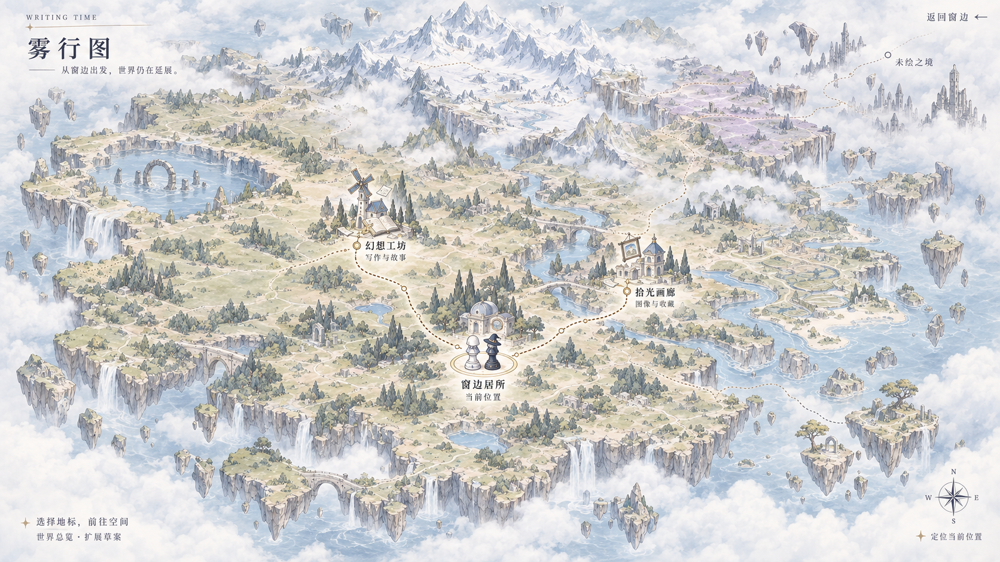
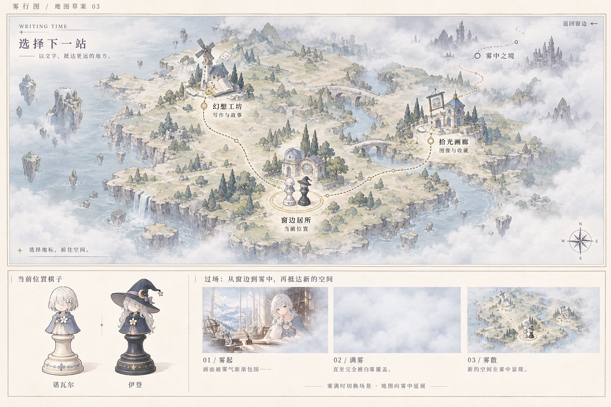

# Writing Time「雾行图」世界地图设计与实施流程

> 面向执行者：GPT-6 Sol  
> 编写日期：2026-09-23  
> 项目：`W:\Machine\VSCode\Java\Writing-Time`  
> 文档性质：经用户选择方向后的详细实施交接；本轮只编写文档，没有实现页面。  
> 核心任务：把主页的功能抽屉改为通过浓雾过渡进入的、可拓展的 JRPG 世界地图。

## 1. 先理解用户最终选择

用户已经否定两种方向：普通纸质功能卡，以及带拱形金边的西幻入口卡。不要重新回到卡片菜单方案。

最终方向如下：

1. 第一层保留现在的诺瓦尔窗边主页，包括法线光照、风格化着色、昼夜变化和人物细微动态。
2. 点击「开启我的空间」后，浓雾逐渐覆盖整个视口。
3. 在雾完全遮住画面时，底层从窗边主页切换为独立地图场景。
4. 雾散后出现淡彩手绘的异世界地图，通过建筑地标进入功能模块。
5. 诺瓦尔和伊登以西洋棋式人物棋子站在同一位置，表示当前所在地点。
6. 地图需要足够大，已上线模块只占起始区域，外围保留未来增加功能的地形空间。
7. 风格简洁、安静、有日系西幻异世界气息；功能、装饰和交互都应克制。

本项目仍然是写作与收藏网站。地图承担导航，不需要角色养成、任务系统、背包、货币或战斗机制。

### 1.1 需求确定程度

| 内容 | 状态 | 执行方式 |
| --- | --- | --- |
| 浓雾过渡、地图导航、双人物棋子 | 用户明确要求 | 必须实现 |
| 更大的世界版图和未来拓展空间 | 用户明确要求 | 必须实现 |
| 淡彩大陆、浮岛、湖泊、雪山等视觉方向 | 用户已初步认可 | 以参考图为准，可为可读性做微调 |
| 初次聚焦起始区域、拖动缩放、定位当前位置 | 配套交互建议 | 作为首版建议实现，具体参数经浏览器调试确定 |
| 动画毫秒数、色值、文件拆分、坐标 | 本文实施建议 | 可以调整，但不能改变核心体验 |
| 地图变成真实 3D、动态生成地形、无限地图 | 未提出 | 不在本轮范围 |

## 2. 参考图及使用优先级

### 2.1 最新的大地图：空间布局和规模基准



文件：`docs/design-references/mist-world-expanded-v4.png`

这张图决定大陆规模、起始区域的位置、外围地貌、整体颜色和地图的疏密关系。

### 2.2 前一版：棋子和过渡概念基准



文件：`docs/design-references/mist-world-pieces-transition-v3.png`

只使用其中的棋子造型与「雾起—满雾—雾散」概念。不要把底部说明栏、棋子放大图或分镜嵌入真实页面。

两张图均为内置 ImageGen 生成的设计草图，不是已经分层的生产素材。图内文字、路线、棋子和界面控件不能视为独立可用资产。

如两张图存在冲突：地图范围以扩大版为准；棋子近景以早期分镜为参考，再用项目角色设定校准。生成图中的细小文字、装饰误差可以修正。

## 3. 修改前的代码调查

### 3.1 先读这些文件

| 文件 | 用途 |
| --- | --- |
| `app/page.tsx` | 当前首页入口，渲染 `DreamHome` 并引入样式 |
| `components/home/DreamHome.tsx` | 首页状态、欢迎内容、入口按钮、旧抽屉及光照参数 |
| `app/dream-home.css` | 首页场景、旧抽屉、移动端和减少动态效果规则 |
| `components/home/RelightScene.tsx` | WebGL 场景、绘制循环、资源加载及上下文恢复 |
| `lib/home/ambient-motion.ts` | 当前人物与环境动态时间线；以执行时文件为准 |
| `lib/home/relight-shaders.ts` | 法线光照、人物局部动态 |
| `lib/home/atmosphere-shaders.ts` | 浮尘及环境效果 |
| `lib/home/postprocess.ts` | HDR、泛光等后处理 |
| `docs/home-design.md` | 已有首页设计与修改记录 |
| `docs/主页细节设计要求详细准则.md` | 之前 Ambient Life 任务的保留要求 |
| `docs/character-bible.md` | 人物身份与视觉设定 |
| `scripts/verify-home-motion.cjs` | 已有首页动态回归工具 |

前一份 Ambient Life 文档的「不重新设计首页」是历史任务范围；本次用户已明确要求重新设计功能入口与第二层页面，因此这部分有新的授权。人物、光照和动态效果的保护要求仍然适用。

### 3.2 已确认的现状

- 项目使用 Next.js 16、React 19、TypeScript，已经依赖 `motion`，不需要为了转场另加大型动画库。
- 首页实际入口是 `DreamHome`。不要仅凭名称修改可能属于旧实现的 `HomeDashboard`。
- 原有导航目标是 `/workshop` 与 `/archive-gallery`，对应页面已经存在。
- `DreamHome` 的 `open` 状态控制 `.dream-drawer`。
- `.is-open .dream-scene` 在桌面上使用 `translateX(-18%)`，移动端使用 `translateX(-3%)`。
- 入口按钮和抽屉使用 `backdrop-filter`；这是本轮要替换的视觉与空间逻辑。
- 首页主背景当前为 `/assets/home/enhance-noval-observatory.webp`，不要误切到备用 `final` 版本。
- `RelightScene` 已有后台暂停和恢复逻辑，但「标签页可见、首页被地图遮住」是新的暂停条件。
- 当前全局减少动态效果规则会关闭 CSS 动画与过渡。因此不能把逻辑完成完全依赖于 `transitionend`。

开始实施时运行 `git status --short`。编写本文时工作区已有首页、着色器和相关文档的未提交修改；这些是现有工作，不能覆盖、回滚或清理。先读取最新文件，不要按本文描述盲目套旧补丁。

## 4. 页面分层与范围

使用一个视口容器承载三个独立层级：

```text
PortalRoot
├── HomeScene       第一层：现有窗边插画与欢迎界面
├── WorldMapScene   第二层：地图、路线、地标、棋子
└── FogTransition   最上层：雾幕、完全遮挡底色、必要的加载反馈
```

建议层级：主页 0，地图 10，地图固定控件 20，雾幕 100，转场恢复控件 110。具体值可以调整，但不要跨组件随意竞争 z-index。

要求：

- 地图与主页各自占满视口，以叠层方式交替显示。
- 切换不修改主页画布宽高，不推挤背景，不通过侧栏挤出空间。
- 删除旧功能抽屉与其 `is-open` 位移规则，保留光照调色手记的功能与样式。
- 第一层的品牌、时钟、欢迎词、光照控制不直接照搬到地图上；地图有自己的简洁界面。
- 雾幕完成后必须移除命中拦截，不得留下透明覆盖层。
- 暂不新建地图路由。首版可保留为 `/` 内部第二场景，模块地址保持原样。

首版可以让两个场景保持挂载，以保存状态、避免资源反复初始化，但隐藏场景必须停止持续绘制并退出交互与辅助技术浏览范围。

## 5. 美术方向与可拓展地图结构

### 5.1 视觉语言

- 地形：近俯视手绘地图，建筑有轻微斜视角，避免厚重的 3D 沙盘块面。
- 笔触：细铅笔线、淡墨轮廓、低饱和水彩铺色，地形细节弱于入口地标。
- 主色：象牙白、雾蓝、灰绿、少量灰紫；古金只用于路线节点和当前位置。
- 气氛：浮空岩层、薄云海、溪流、断续的古桥与远方轮廓提供异世界感。
- 留白：外围优先保留空地，不用密集建筑填满每个角落。
- 字体：优先复用现有中文衬线与无衬线字体变量；标题有文学气质，辅助文字清晰。
- 避免整屏泛黄旧羊皮纸、繁复花边、霓虹法阵、毛玻璃面板和大面积黑色游戏 HUD。

建议起始色值，最终以浏览器截图校准：

| 用途 | 参考值 |
| --- | --- |
| 纸白、雾的底色 | `#F3F1E9` |
| 水体、远景 | `#B9C9D7` |
| 草地 | `#C8CCB8` |
| 正文、地标标题 | `#3F4858` |
| 辅助文字 | `#626B72` |
| 路线与定位细线 | `#A48C61` |

这些值是提案，不能代替文字对比度检查。普通正文目标至少 4.5:1；文字可有极淡纸色局部描边，不添加整张卡片底板。

### 5.2 地理层级

| 区域 | 地貌 | 当前用途 |
| --- | --- | --- |
| 中南部起始区域 | 平缓台地、河流、蓝顶建筑 | 放置三个实际地点 |
| 西部 | 森林、草地、古桥 | 留给后续功能 |
| 西北部 | 环湖高地、简洁石环 | 留给后续功能 |
| 北部 | 雪山、山口、盆地 | 留给后续功能 |
| 东北部 | 淡紫高原、浮石 | 留给后续功能 |
| 东部 | 河谷、梯田海岸 | 留给后续功能 |
| 东南部 | 独立小浮岛、跨岛通道 | 留给后续功能 |

上述只是美术分区，不代表已有新模块。不要擅自给预留区域编造页面或增加可点击的假入口。

起始区域约占世界范围的三分之一，其余区域以自然地形和较浅路径提示延展空间。「未绘之境」可作为环境文字，不能与真实入口使用相同强调程度。

### 5.3 地标与实际导航

| 地点 | 地标形象 | 行为 |
| --- | --- | --- |
| 窗边居所 | 圆顶观测小屋 | 当前地点；激活后可通过反向雾幕返回首页 |
| 幻想工坊 | 风车塔楼、书页、书桌意象 | 导航到 `/workshop` |
| 拾光画廊 | 浅色蓝顶展馆、画框意象 | 导航到 `/archive-gallery` |

整座地标与附近文字都提供可点击区域，桌面和触屏命中范围至少 44×44 CSS 像素。视觉不用额外画出点击框。

悬停与键盘焦点：轻微加深地标、出现细定位环或短文字提示即可。避免建筑跳动、变大很多或闪烁。

## 6. 素材编辑流程：先分离，再组装

### 6.1 最重要的素材原则

不能把参考图原封不动设为背景，再覆盖一套文字和棋子。这会出现重复标签、固定棋子、固定按钮、难以定位的假热点，后续扩展也会变得困难。

推荐分为：

1. **地形底图**：大陆、水体、山脉、树林、装饰建筑、边缘环境雾；不包含界面文字、三个功能建筑、棋子、交互路线和 UI。
2. **三座地标**：各自透明素材，底部接地阴影克制，视角和色温统一。
3. **两枚棋子**：各自透明素材，身份、颜色、底座比例一致。
4. **路线和定位环**：SVG / CSS 绘制，来自数据，不能烘焙进底图。
5. **所有标签与控件**：真实 DOM 文本与按钮 / 链接。
6. **过渡雾纹理**：少量可复用的柔边透明雾片；完全遮挡由独立纯色底层保证。

素材生产先做一套质量稳定的地图。首版不需要地图瓦片服务器、无限生成或 WebGL 地形引擎。

### 6.2 建议素材目录

```text
public/assets/world-map/
  terrain.webp
  terrain-mobile.webp             # 有实际收益时再提供
  landmarks/home.webp
  landmarks/workshop.webp
  landmarks/gallery.webp
  pieces/noval.webp
  pieces/eden.webp
  fog/fog-a.webp
  fog/fog-b.webp
```

源 PNG 和生成记录可放在项目的设计素材目录，不必全部进入浏览器加载路径。不要把参考稿复制到 `public` 就声称已完成素材生产。

建议底图长边 3072–4096 像素，保持最终统一宽高比；地标源图约 512–768 像素，棋子约 256–512 像素。先检查放大效果与下载体积，再决定是否增加分辨率。透明素材必须是真透明，不能带棋盘格或白色矩形。

若使用图像生成技能，遵循该技能的当前流程。生成地图时将参考图作为地理与风格参考；保留中南部接地点、道路走向和地图比例，不让重新生成后的地标坐标仍沿用旧图而产生错位。

### 6.3 地形编辑提示词范本

> 基于已选定的扩大版雾行图，制作生产用淡彩 JRPG 地形底图。保持大陆轮廓、河流、湖泊、雪山、森林、高原、浮岛和中南部起始区域的构图。删除所有文字、品牌、按钮、指南针、定位环、虚线路线、棋子，以及三个功能建筑；原位置保留自然空地供后续叠加。淡墨线与低饱和水彩，象牙白、灰绿、雾蓝，边缘轻雾，主体地形清晰。不要新增建筑群，不要文字、UI、水印，不要改变地图宽高比。

### 6.4 地标制作提示词范本

> 为现有淡彩异世界地图生成单个透明背景地标：[窗边圆顶观测小屋 / 风车与书页意象的幻想工坊 / 蓝顶浅石拾光画廊]。近俯视斜角，细铅笔线、低饱和水彩，与地图建筑比例一致。完整轮廓，接地点位于底部中央，少量接地阴影。无文字、无边框、无人物、无棋子、无背景色块。

### 6.5 棋子设计

角色准确性以这些文件为准：

- `public/assets/characters/noval/character-sheet.webp`
- `public/assets/characters/eden/character-sheet.webp`

诺瓦尔：银白短发、小侧束与蓝色缎带、花朵饰件、浅蓝披肩；棋身以象牙白为主。

伊登：银灰长发、宽檐尖顶魔女帽、月牙与星饰、灰紫缎带、深蓝披肩；棋身以深蓝灰为主。

共同造型：人物特征集中在上半部，下半部为收腰、阶梯圆底座的西洋棋轮廓。不要做成带两条腿的普通 Q 版人物，也不要只用普通黑白棋子丢失角色身份。

提示词范本：

> 依据角色设定，生成一枚西洋棋式角色棋子。保留[角色关键特征]，上部为简化头部与披肩，下部为优雅收腰棋身及阶梯圆底座。哑光陶瓷与淡彩手绘质感，小尺寸轮廓清晰，与地图的轻斜俯视角一致。透明背景、无文字、无棋盘、无展示台、无大片投影。

先检查两枚棋子的底座宽度、头部比例、视角与阴影是否一致。初始两枚一起位于窗边居所，构成一个当前位置，不应显示成两个玩家各处一地。

## 7. 数据与地图坐标

### 7.1 使用稳定世界坐标

建议设定一个固定逻辑画布，例如 3200×1800；美术底图也使用相同宽高比。坐标以 0–1 归一化存储，转换成世界像素后统一投影。

不要用屏幕百分比单独定位建筑，也不要把文字摆在与地图无关的固定位置。地图移动或缩放时，地形、路线、地标、棋子必须共享同一套坐标变换。

建议数据结构，字段可按项目风格调整：

```ts
type Point = { x: number; y: number }; // 0..1，在完整地图中的位置

type MapDestination = {
  id: string;
  title: string;
  description: string;
  kind: "home" | "module";
  href?: string;
  position: Point;                   // 建筑接地点，而不是图片左上角
  labelOffset: { x: number; y: number }; // 屏幕 CSS 像素
  asset: string;
  worldWidth: number;                // 世界单位中的显示宽度
  regionId: string;
};

type MapRoute = {
  id: string;
  from: string;
  to: string;
  points: Point[];
  status: "active" | "future";
};

type MapRegion = {
  id: string;
  bounds: { x: number; y: number; width: number; height: number };
  status: "available" | "reserved";
};
```

草图初始测量参考：窗边居所约 `(0.49, 0.64)`；幻想工坊约 `(0.36, 0.44)`；拾光画廊约 `(0.63, 0.52)`。这些不是精确热点，必须在清理后的底图上重新校准建筑接地位置、路线端点和标签偏移。

`currentLocationId` 初始为 `home`。相机平移、点击空地或悬停其他建筑不能改变当前位置。未来若需要保存模块位置，应另行定义完整语义；首版不伪造角色已经抵达。

### 7.2 视口投影与点击反算

一种易维护的相机表示：`camera = { centerX, centerY, scale }`，中心为世界单位，scale 为 CSS 像素 / 世界单位。

```text
screenX = viewportWidth / 2 + (worldX - centerX) * scale
screenY = viewportHeight / 2 + (worldY - centerY) * scale

worldX = centerX + (screenX - viewportWidth / 2) / scale
worldY = centerY + (screenY - viewportHeight / 2) / scale
```

缩放时先计算鼠标或双指中心下的世界位置，再调整相机中心，使该位置在缩放前后保持在同一个屏幕点，避免地图跳动。

标签和点击区域推荐投影到屏幕空间，保持稳定字号和最小命中尺寸；地形和建筑留在世界空间。棋子可以设置屏幕尺寸上下限，避免总览时小到无法识别，也避免放大时遮住整座建筑。

不要因为 DOM 标签固定大小就忘记同步位置。resize、缩放、拖动后都应使用同一帧相机数据更新投影。

### 7.3 相机范围

- 世界总览：能看见大陆全貌及适度边缘雾。
- 默认进入：优先框住三个实际地点，并预留标题、工具栏和安全区。
- `fitBounds` 应把地标宽高、棋子、文字外扩尺寸算进去，而不仅计算三个坐标点。
- 当移动端无法同时做到「全看见」与「标签清晰」时，保持当前地点清晰，提供目的地导航来移动视野，不强行缩成一张小图。
- 缩放范围可从约总览比例到其 2.5 倍开始调试，不把建议数值写成不可变要求。
- 拖动限制按当前比例与世界边界计算；某轴内容小于视口时居中，不能产生负边界抖动。
- 全屏底色沿用雾色，地图边界外不得出现黑边或棋盘格。

## 8. 浓雾过渡的视觉与状态机

### 8.1 视觉目标

从窗边进入地图，像视线穿过一层浓雾。雾有轻微方向性和层次，但不形成烟花、爆炸、法阵或强闪光。

采用两到三片柔边雾纹理，用平移、缩放和透明度营造卷入与散开。避免运行时超大模糊滤镜或多层高频噪声着色器。

**纯色覆盖底层是正确切换的保障，雾纹理只是美术表现。** 透明雾片即使叠加也可能留下缝隙，不得用「看起来差不多白了」作为切换条件。

首页到地图的建议时间线：

| 阶段 | 起始建议 | 行为 |
| --- | --- | --- |
| 即时反馈 | 点击后 0–80ms | 入口有轻微按下反馈，关闭调色面板 |
| 雾起 | 0–380ms | 雾从边缘卷入，底色遮罩逐渐达到完全不透明 |
| 满雾 | 380–460ms | 覆盖整个视口；确认资源可用后切换活动场景 |
| 雾散 | 460–920ms | 地图由中心向边缘显露，纹理退出 |
| 结束 | 约 920ms | 雾层取消命中，焦点交给地图 |

这是一段场景叙事过渡，因此可比普通按钮动画稍长。实际应在约 0.8–1.1 秒范围内调节；不要为等待纹理动画让用户停在白屏数秒。

首次资源加载时间不算入稳定动画时长。资源已缓存时，过渡必须具有一致节奏。

### 8.2 推荐状态

```text
home-idle
  → covering(target=map)
  → covered(target=map)
  → revealing(scene=map)
  → map-idle

map-idle
  → covering(target=home)
  → covered(target=home)
  → revealing(scene=home)
  → home-idle
```

单独记录 `activeScene`、`requestedScene`、`phase` 和本次转场的 `transitionId`。不要用几组互相独立的布尔值拼出可能矛盾的状态。

核心不变量：

1. `activeScene` 只能在覆盖底色实际达到完全不透明之后改变。
2. 满雾层至少经过一帧实际绘制，再提交底层切换；不能在同一次 React 批处理中瞬间全做完。
3. 地图完成解码和布局、相机有效之后才能揭雾。
4. 旧转场的完成回调必须核验 `transitionId`，不得覆盖新状态。
5. 任意异常、取消或卸载都能结束资源监听和动画任务。
6. 进入 idle 后，雾层不可接收点击；只有当前场景可导航。

可使用已有 Motion 或浏览器动画能力，但必须验证其取消和完成语义。不要只堆叠几个 `setTimeout` 实现完整流程，也不能把正确性绑定到某张纹理的动画事件。

### 8.3 连续输入与取消

- 重复点击当前目标是幂等操作，不重复创建雾层或导航。
- 雾未满时按 Esc 返回：取消进入请求，让雾平滑退回当前场景。
- 已经满雾时收到反向请求：在完全遮挡下选择最终目标，再揭开；不要先露出错误场景再补一轮动画。
- 正在揭雾时请求返回：重新覆盖，再切换，保持场景只能在遮挡下改变的规则。
- 转场期间阻止底下地标误触，但允许明确的 Esc / 返回取消请求；不能将用户锁死。
- 拖动地图时不触发首页曾有的全局左右滑动开关；移除旧冲突手势。

### 8.4 资源就绪和失败路径

进入地图前准备：地形底图、三座地标、两枚棋子及转场纹理。关键图片需经过 `decode()` 或等价就绪检查，不能只检查网络请求已返回。

- 首页关键场景加载后，可在空闲时预热地图；入口 focus / pointerenter 也可触发预热。
- `idle callback` 使用前检查支持，提供取消与普通调度回退；不能假设所有浏览器都有。
- 用户很快点击时允许进入覆盖阶段，但只在资源就绪后揭雾。
- 满雾等待超过约 700ms 时，显示「正在展开地图…」和取消入口。
- 超过约 8 秒或关键资源加载失败，结束无反馈等待，显示重试与返回；具体阈值集中定义。
- 雾纹理失败：用纯色柔和遮罩完成过渡。
- 地图关键底图失败：不能揭开空白地图；返回首页并提供重试。
- 可选装饰素材失败：可跳过，真实功能入口仍需可达。

页面进入后台时暂停动画；恢复后按当前状态重算，不执行过期计时器导致揭雾穿帮。恢复目标是一个正确、可交互的场景，不要求补播后台期间每一帧。

### 8.5 减少动态效果

遵循系统 `prefers-reduced-motion`。过渡改为约 120–180ms 的简单淡变，或直接受控切换；不使用漂移雾、镜头移动与棋子浮动。

逻辑上仍要保证资源就绪和场景互斥。CSS 禁用动画后也必须完成状态，不等待永远不会发生的 `animationend`。

原有「允许人物动效」开关不应自动等同于允许所有地图与雾幕动画。首版地图按系统偏好处理，不额外新增复杂设置面板。

## 9. 保留首页渲染与生命周期

主页仍是完整原画，入口改造不能改变原来的色图、法线、着色参数和人物构图。

建议入口为克制的小型星图 / 指南针标记加「开启我的空间」文字，使用现有色系与细线，不再做大面积毛玻璃按钮。功能目标要有明确可读文案，不能只有神秘图标。

进入地图后：

- 保留调色参数、实际时间跟随状态、用户的暂停选择和减少动态偏好。
- 关闭调色面板，避免其留在地图上方。
- 首页画布可以保留挂载，但必须暂停持续绘制和动画时间推进。
- 不要仅把 `moving` 改为 false 来冒充隐藏场景暂停：用户暂停状态与场景可见性需要分离。
- 可为 `RelightScene` 增加最小必要的 `active` / `suspended` 输入，使 `schedule` 和 RAF 同时判断场景可见性及 `document.hidden`。
- 暂停时停止 RAF；恢复时重置上一帧时间，避免呼吸、眨眼突然快进。
- 满雾返回首页时，恢复渲染并等待有效画面，再揭雾；不要露出未初始化画布或旧尺寸画面。
- 保留 WebGL 上下文丢失恢复与静态底图降级路径。

不要为了雾效改写现有光照 shader 或把雾合入人物法线渲染。独立叠层更容易控制、恢复和测试。

## 10. 地图交互与响应式

### 10.1 桌面

- 空地按住拖动；使用 Pointer Events 和 pointer capture 统一鼠标 / 触笔 / 触屏处理。
- 移动超过约 6–8 CSS 像素再认定为拖动；拖动结束抑制同次输入的点击，避免误入模块。
- 支持围绕指针位置缩放，提供可见的放大、缩小、总览、定位当前位置控件。
- 不拦截浏览器 Ctrl / Cmd 加滚轮的页面缩放习惯；滚轮缩放仅限地图交互区域。
- 拖动中的 cursor 可用 grabbing；地标维持清晰的可点击反馈。
- 默认不添加长惯性滑行。相机调整应短而稳定，减少动态模式直接定位。

### 10.2 移动端

- 地图独占视口，适配 `100dvh` 与安全区；不要继承首页 `min-height: 680px` 导致短屏溢出。
- 单指平移、双指缩放；pointercancel、丢失捕获、手指离开视口都要清理手势状态。
- `touch-action` 只针对地图交互面设置，不能在全站阻断正常滚动或禁用浏览器可访问缩放。
- 名称和控件保持可读字号，不随整幅大陆一起缩小。
- 提供一个简洁的「目的地」按钮，打开可访问的文本导航，可选择三个实际地点；这是地图的替代操作，不再建立视觉主卡片菜单。
- 选择目的地后可直接导航；用于查看的定位操作与进入模块操作应保持明确。
- 工具条不能遮住当前棋子；横竖屏切换后保留世界中心并重新限制相机范围。

### 10.3 键盘和语义

- 功能模块使用真实链接，保留在新标签页打开等标准行为。
- 返回首页 / 总览 / 缩放 / 定位使用按钮。
- Tab 可到达所有目的地和控件；Enter 或 Space 按元素原生语义操作。
- 不要求键盘用户先拖动地图才能找到功能，文本导航始终可达。
- 地图作为第二场景，不要误设为必须困住焦点的模态对话框。
- 非活动场景设置 `inert` 和适当的 `aria-hidden`，避免双场景同时被阅读。
- 切换后焦点移到地图标题或导航起点；返回时恢复到入口按钮，不能留在隐藏节点。
- 装饰图层 `aria-hidden`；棋子组用一个可读说明表达「当前位置：窗边居所，诺瓦尔与伊登」。

### 10.4 导航和返回约定

首版不必为地图额外写入浏览器历史。清楚区分：

- 地图的「返回窗边」：受控反向雾幕。
- 激活「窗边居所」：同样返回首页。
- 点击功能地标：进入既有模块地址，不为了播放棋子行走动画延迟导航。
- 从模块返回 `/`：建议读取当前标签页的 `sessionStorage`，恢复地图和最近相机；保存内容需带版本号并验证有限数值与缩放范围。
- 用户明确返回窗边后，保存的活动场景应更新为 home。
- 不强行添加假历史项，不让浏览器 Back 在主页和地图之间陷入循环。

读取会话状态只能在客户端执行，防止 hydration 不一致。恢复地图时先保持安全底色 / 雾层，完成资源和布局准备，避免先闪出首页再跳地图。若首版没有实现会话恢复，交付时明确说明返回行为，不能声称已支持。

## 11. 建议文件组织

按当前项目习惯调整，避免过度拆分；下面表示职责，不是硬性要求每项都创建文件。

```text
components/home/DreamHome.tsx           # 保留首页设置，接入场景协调
components/home/RelightScene.tsx        # 仅必要的可见性暂停接口
components/home/world-map/
  WorldMapScene.tsx                     # 地图页面与加载状态
  MapViewport.tsx                       # 相机、手势和 resize
  MapLandmark.tsx                       # 地标、标签、语义链接
  CharacterPieces.tsx                   # 当前地点棋子组
  MapControls.tsx                       # 总览、缩放、定位、文本导航
  FogTransition.tsx                     # 纯视觉与完成回调
  usePortalTransition.ts               # 状态机与取消、恢复逻辑
lib/home/world-map/
  destinations.ts                      # 地点、区域、路径配置
  camera.ts                            # 投影、边界和 fitBounds 纯函数
app/world-map.css                      # 独立地图样式
```

可采用 DOM + SVG + CSS 实现地图，相机变换使用 transform。无需引入 Three.js、地图 GIS 库或第二套 WebGL 渲染器。

若用 Motion，先查看项目已有用法及实际安装版本；不要在未核实 API 时照搬其他版本示例。

## 12. 推荐执行顺序与每阶段完成标准

### 阶段 A：记录基线

1. 阅读现有实现、当前工作区差异与角色设定。
2. 使用实际运行端口捕获首页桌面、移动端、日间与夜间基线。
3. 记录入口、调色面板、动效开关、法线诊断和两个模块路由是否正常。
4. 确认所需浏览器测试工具，已有脚本依赖 Playwright，但 `package.json` 未声明它，不假定可直接运行。

完成标准：知道哪些效果必须保留，并可复核前后变化。

### 阶段 B：生产和检查素材

1. 从扩大版参考图制作无文字、无交互元素的地形底图。
2. 生成或编辑三座透明地标、两枚棋子、少量雾纹理。
3. 检查透明边缘、比例、色温和视角，压缩为合适格式。
4. 在固定画布中校准所有接地点与路线；记录最终素材尺寸和坐标。

完成标准：图层能独立组合，不依赖一张烘焙了全部 UI 的图。

### 阶段 C：实现静态地图导航

1. 建立地点、区域、路线配置。
2. 渲染底图、地标、DOM 标签、棋子和固定控件。
3. 先在固定相机下验证实际模块链接和返回动作。
4. 调整层级和文字对比，不先加入复杂动画。

完成标准：地图已经是一张可用的功能导航，而不只是截图背景。

### 阶段 D：相机和响应式

1. 添加投影、fitBounds、缩放和边界限制。
2. 添加拖动与误点击抑制。
3. 加入总览、定位、移动端文本导航。
4. 验证 resize、横竖屏、标签屏幕尺寸及棋子跟随。

完成标准：大地图能够探索，当前入口和人物不会丢失。

### 阶段 E：接入独立第二场景

1. 删除旧 drawer 的 JSX、无用图标及专属样式。
2. 删除旧 `is-open` 背景位移、移动端欢迎词压缩与全局横滑开关。
3. 保持光照参数面板与首页构图。
4. 接入两个场景的显示、交互隔离和渲染暂停。

完成标准：无需动画也能在完整主页和完整地图之间正确切换，没有背景挤压。

### 阶段 F：浓雾状态机

1. 先用纯色覆盖验证状态机、资源等待、取消、重复操作和错误恢复。
2. 再叠加柔边雾纹理，调节卷入与散开。
3. 验证完全遮挡后才切换，并在新场景准备好后揭雾。
4. 实现减少动态效果、后台恢复和焦点恢复。

完成标准：动画承担连续过渡，任何中途操作都不会露出错误场景或留下透明拦截层。

### 阶段 G：收尾与交付

1. 执行下述检查，修复实际问题。
2. 保存关键截图和一段来回转场录屏。
3. 更新 `docs/home-design.md`，记录最终结构、资源路径和已验证的限制。
4. 删除仅属于本次开发且已无用途的临时内容；不碰其他未提交文件。
5. 汇报改动、验证结果、素材情况和仍存在的限制。

## 13. 验收矩阵

### 13.1 视觉

- 首页人物、构图、法线光照、调色参数、眨眼与环境动态没有意外退化。
- 地图明显大于起始区域，外围有多种可扩展地形，而非把三座建筑放大填满屏幕。
- 三个真实地点容易识别；装饰性建筑不能比真实入口更突出。
- 地图上的中文为实际 DOM 文本，没有图片文字与 DOM 文字重影。
- 两枚棋子外观可辨、同处一个定位圈，底座接地，不像悬浮头像。
- 没有旧毛玻璃抽屉、背景横移或页面挤压。
- 首次进入没有地图纹理迟到、棋子闪现、标题重排和黑边。

### 13.2 关键行为场景

| 场景 | 预期 |
| --- | --- |
| 首页进入地图，再返回 | 每次在满雾时切换，首页参数保留 |
| 连续快速点击入口多次 | 只发生一个有效转场 |
| 雾起、满雾、雾散三个阶段按 Esc | 按约定回到正确场景，无卡死 |
| 地图未解码 / 网络慢 | 有加载反馈，可取消，不揭开空白页 |
| 地图图片失败 | 有重试和返回，主页可继续使用 |
| 雾纹理失败 | 简单遮罩过渡仍可完成 |
| 转场中切标签页再回来 | 不被过期回调覆盖，最终场景可操作 |
| 转场中改变窗口尺寸 | 遮罩仍覆盖整个视口，没有边缘漏底 |
| 拖动经过地标并松手 | 不误触模块导航 |
| 缩放后点击地标 | 命中位置与视觉位置一致 |
| 地图视野移到边缘，再定位当前位置 | 正确回到棋子所在地点 |
| 系统减少动态效果 | 无大幅雾移动，也不等待失效的动画事件 |
| 地图中隐藏首页 | 首页 RAF 停止持续运行，用户暂停选择未被篡改 |
| 返回首页 | RAF 正确恢复或按原暂停状态静止，无动画快进 |
| WebGL 不可用 / 上下文恢复 | 保留既有静态降级与恢复能力 |
| 仅键盘操作 | 两个模块、返回、相机控件均可达 |
| 浏览器缩放与文字放大 | 控件不重叠、功能仍可用 |

建议至少检查：1440×900、1920×1080、1024×768、390×844、360×640，以及一组手机横屏尺寸。应按视口实际尺寸检查，不只在大屏里缩小截图。

### 13.3 有价值的自动化检查

可为以下逻辑添加精简测试，而不是机械测试每个组件是否渲染：

- 世界 / 屏幕坐标互转、围绕指针缩放不漂移、不同宽高比的边界限制。
- 状态机的反向请求、重复请求、过期完成回调和资源失败恢复。
- 浏览器端检验拖动不导航、转场结束雾层不拦截、隐藏层不可聚焦。
- 在普通动画与减少动态两种模式下验证可完成往返。

推荐给转场容器提供低成本的 `data-scene`、`data-phase` 等调试属性，使测试等待真实状态，而不是固定睡眠。

转场录屏应逐帧抽查最容易穿帮的两段：满雾提交前后、雾散开始时。检查的是全视口遮挡与场景连续性，不以单个中心像素变白作为证明。

### 13.4 构建与性能

按实际环境执行：

```powershell
npm run lint
npm run build
```

已有动态检查可在确认 Playwright 可用后运行，设置实际端口：

```powershell
$env:HOME_URL = 'http://localhost:3100'
node scripts/verify-home-motion.cjs
```

不要假定 3100 一定是当前服务端口。构建会运行既有 `prebuild` 同步脚本，应先了解其行为，避免把环境或基线问题误报为此次改动造成。

性能目标：普通桌面转场与拖动尽量稳定在 60fps；低性能设备优先减少雾层和装饰，不降低入口可用性。没有 profiler 或实际帧时间数据，就不要宣称已经达到指标。

首屏优先加载主页，不让整张世界地图阻塞人物场景。地图闲置时无持续高频相机更新；隐藏主页不持续绘制。首版地图关键压缩资源建议控制在约 5 MB 以内，作为优化目标而非对当前素材的已测量结论。

## 14. 后续增加功能区的标准流程

1. 在预留地形中选择接地点，确保有足够建筑、标签和交互空间。
2. 添加对应功能路由，并确认可用。
3. 制作一座与现有视角、线条和色温一致的透明地标。
4. 在地点配置中添加记录，在路线配置中连接现有节点。
5. 更新默认镜头或区域导航时，避免让初始首页一次塞满所有远方地点。
6. 检查标签碰撞、命中尺寸、键盘导航与移动端文本入口。
7. 只有新地区真正启用时才强化路径和散开区域雾，不显示未实现功能的假入口。

正常增加一个地标应主要改「配置 + 素材 + 路由」，不应改动整个地图组件或重新生成全大陆。

首版底图容量仍然有限；本文承诺的是预留范围内的数据驱动扩展，不是无限地图。未来真要超出大陆边界，再考虑分区底图或世界版本更新，不提前建设重型编辑器。

## 15. 最终交付清单

- [ ] 保留原有动态窗边主页，并完成更合适的入口样式。
- [ ] 完整独立的扩大版地图场景。
- [ ] 三个实际地点、两个模块真实路由。
- [ ] 诺瓦尔与伊登独立棋子素材及当前位置语义。
- [ ] 数据驱动的地标、路径和预留区域。
- [ ] 基础拖动、缩放、总览和定位，移动端替代导航。
- [ ] 浓雾转场、完全遮挡保证、取消与失败恢复。
- [ ] 系统减少动态、后台恢复、焦点及交互隔离。
- [ ] 首页隐藏时暂停绘制，返回后维持原用户设置。
- [ ] 分辨率与行为验收记录，必要的回归检查。
- [ ] 最终截图、转场录屏、素材与修改说明。

## 16. 可直接交给 GPT-6 Sol 的启动指令

> 请在 `W:\Machine\VSCode\Java\Writing-Time` 项目中实施 `docs/雾行图世界地图设计与实施流程.md`。先完整阅读本文、两张 `docs/design-references` 参考图以及现有 `DreamHome`、`RelightScene` 和相关样式。保留当前首页人物法线光照、风格化着色、昼夜与 Ambient Life 动态，将旧毛玻璃功能抽屉替换为浓雾转场进入的独立 JRPG 世界地图。地图沿用扩大版构图，现有地点集中于起始区域，外围为未来拓展留白；诺瓦尔和伊登使用独立的西洋棋式棋子标记当前位置。按文档分阶段完成素材分离、真实地标导航、相机交互、转场状态机、失败恢复和验收。不要直接把设计截图当成完整可交互界面，不要覆盖工作区已有修改，不要改写现有光照系统。具体参数可在浏览器中调试，最终交付实际实现、关键截图、转场录屏及验证结果。

---

本文及附图是实施交接材料。文中建议的交互、性能目标与异常恢复尚未实现或测试；执行者需要逐项完成并提供证据。
