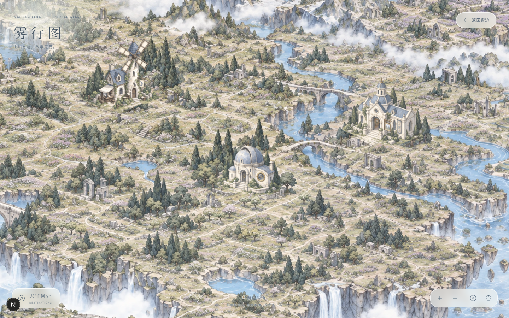
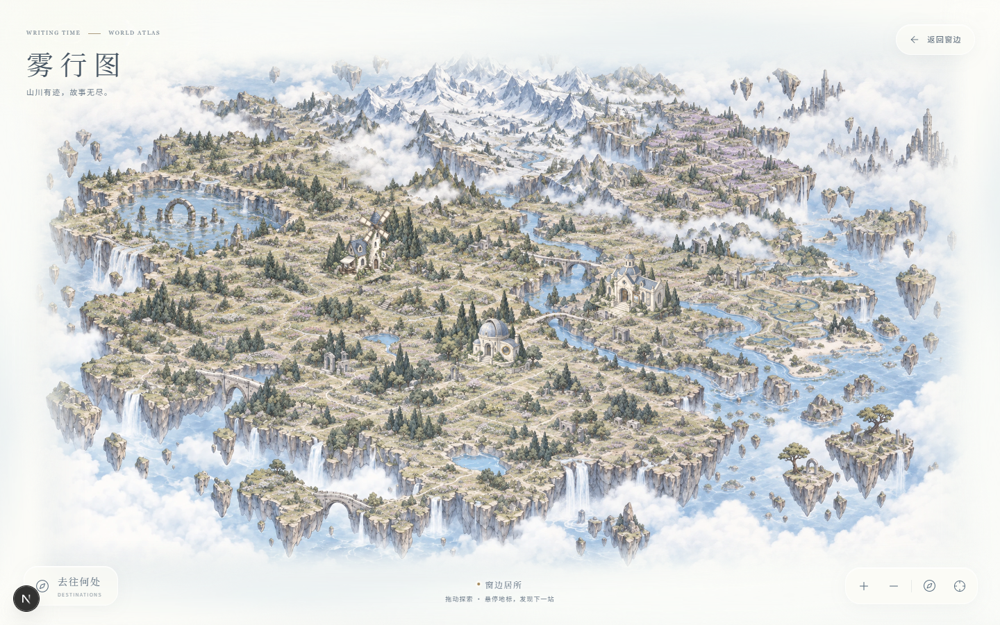
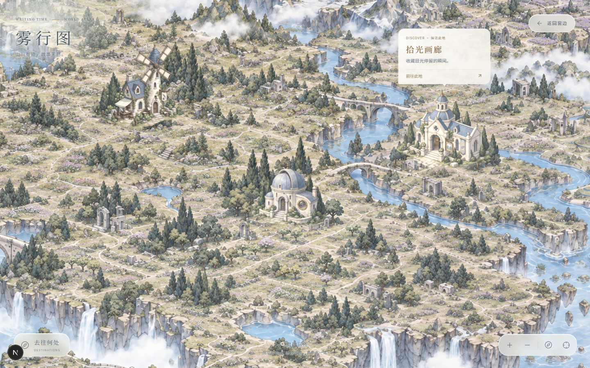

# 雾行图美术与交互收尾记录

日期：2026-09-24。以用户最后指定的灰调、低饱和彩铅风格及双人物棋子草样为准。

## 页面效果

行进与返回录屏：[journey-roundtrip.webm](world-map-evidence/polish/journey-roundtrip.webm)。

## 改动

- 棋子按用户草样重绘，使用小头部、短披肩、显著的收腰棋身和阶梯圆底座；各自为独立透明素材。
- 原地图分为四个重叠地域分别细化，增加花田、遗迹、石阶、石墙、林间路径、岩层、河畔植被和水面细节，保持原有灰调。
- 地图边缘通过地形羽化、大范围柔云及雾色底衔接，避免矩形硬边。
- 地形、路线、建筑、棋子进入同一个世界变换容器，避免快速拖动时彼此脱离。
- 棋子先抬起，沿路线移动，到达建筑后落下，再淡出并导航；Esc 可中途取消。
- 模块页面新增「保存并返回地图」，沿用 `flushSave()`，保存失败时留在原页面。
- 在当前标签页会话保存实际地点，返回地图时恢复棋子和镜头位置；返回窗边后恢复 home 地点。
- 默认隐藏建筑名称，悬停或键盘聚焦才显示纸质说明；触屏首次点按展示，再次点按前往。目的地列表的进入箭头可直接开始旅程。
- 控件改为圆角半透明控制条和轻纸质表面，减少硬边与厚重感。
- 幻想工坊采用相反水平朝向，与其他建筑形成区别；这是二维镜像，不是新建 3D 模型。

## 实现位置

| 文件 | 职责 |
| --- | --- |
| `components/home/WorldMapScene.tsx` | 共享坐标、地图控制、建筑悬停、棋子显示 |
| `components/home/useMapJourney.ts` | 行进、拾起与落下、取消和到达后导航 |
| `lib/home/world-map.ts` | 素材、建筑朝向、路线插值和地点会话状态 |
| `components/app/ReturnToMap.tsx` | 保存并返回地图 |
| `components/app/RootShell.tsx` | 为画廊与工作空间接入返回入口 |
| `app/world-map-polish.css` | 在原地图样式后加载的视觉修整 |
| `app/map-return.css` | 模块返回按钮样式 |
| `components/home/DreamHome.tsx` | 成功返回窗边后重置当前位置 |

行进期间相机必要时跟随棋子，暂停手动地图拖动。当前位置在实际抵达时提交；途中取消回到上个已到达地点，抵达后取消则保留新地点。后台时间不计入正常行进进度。减少动态模式不播放明显抬起效果，使用很短的完成过程。

原生链接保留 Ctrl / Cmd / Shift 修饰点击。会话位置不等于账户级持久化状态。

## 素材与生成记录

使用内置 ImageGen 生成；Sharp 负责透明裁切、压缩和重叠地域合成。旧素材保留，新页面使用新文件名。

- `public/assets/world-map/terrain-detailed.webp`：2912×1640，约 1.69 MB。
- `public/assets/world-map/pieces/noval-chess.webp`：透明棋子，512 像素高。
- `public/assets/world-map/pieces/eden-chess.webp`：透明棋子，512 像素高。

世界逻辑坐标仍为 1672×941。新图不是 4K 原生图，也不承诺无限放大；细节来自重新生成的区域内容，实际交付尺寸如上。

地图从原灰调底图裁出四个 960×540 范围：`(0,0)`、`(712,0)`、`(0,401)`、`(712,401)`，生成前各放大为参考图。生成结果每区 1672×941，再按重叠区域的最小累计色差寻找接缝，窄范围羽化，避免大范围混合出现双重轮廓。打包脚本为 `scripts/build-map-art.cjs`，参数为生成文件所在目录；运行时只依赖项目内打包素材。

### 地图最终提示词集

共用核心：

> Edit the geographically registered region of the existing fantasy world map. Preserve the same crop, camera, river outlines, cliff boundaries and major landforms. Enrich the interior with dense, interesting small-scale landscape detail. Muted gray colored-pencil hand drawing on ivory paper; fine crisp gray outlines, pale dusty blue, sage gray, faded violet and subtle grain. Match the original low saturation and gentle airy luminosity. No vivid blue, green or yellow, no contrast boost, no blur. Maintain the outer overlapping geography for stitching. No UI, text, labels, navigation dots, chess pieces or large new buildings. Landscape 16:9, highest resolution available.

四个区域分别补充：西北环湖古遗迹、苔藓石阶、石柱与野花；东北雪山、阶梯薰衣草花田、柱廊与石墙；西南花草地、果园、引水桥与森林步道；东南浮岛花园遗迹、潮池、碎石路与河畔植被。后三个区域同时以已完成的西北区为颜色和细节密度参考，不复制它的地理构图。

### 棋子最终提示词

> Use the user's supplied two-chess-token sketch as the exact design reference. Create two isolated production sprites on a truly transparent background, no text or border. Small simplified heads and short cloak silhouettes above classic slender lathe-turned chess stems and wide stepped circular bases. Do not add torsos, arms, hands or realistic half-body portraits. Understated faces with tiny eyes. Noval: silver-white bob, flower hairpin, dusty blue short cape and ivory pedestal with minimal blue flower trim. Eden: silver-gray hair, dark navy pointed witch hat with crescent and star, small dark cape and navy pedestal with fine gold rings. Muted gray-blue and cream, delicate colored-pencil texture, matte porcelain, crisp silhouettes at small UI size. Preserve the reference's proportions and quiet mood.

双棋子透明素材表按 alpha 范围裁切为独立 WebP，保留透明度。

## 验证

- `npx tsc --noEmit --incremental false`：通过。
- 修改文件定向 ESLint：通过。
- `node node_modules/next/dist/bin/next build`：通过，包含类型检查和页面生成。
- `scripts/verify-map-polish.cjs`：通过，页面异常为 0。
- 快速交替拖动 16 次，逐次检查建筑底部锚点与世界矩阵投影，最大测得漂移为 0 CSS 像素。
- 完整链路：画廊 → 地图 → 取消前往工坊 → 工坊 → 地图 → 窗边 → 地图。
- 验证棋子先移动再跳转，取消后无延迟跳转，返回后地点正确，默认隐藏名称且悬停展示。
- 验证 390×844、360×640、844×390 触屏 / 减少动态效果模式的往返，无页面横向溢出。
- `scripts/verify-home-motion.cjs`：首页人物动态、像素变化、暂停、系统减少动态及手动开启通过，页面异常为 0。

机器可读结果和截图位于 `docs/world-map-evidence/polish/`。

`npm run dev` 前置同步脚本需写入当前沙箱受保护的 `.git/FETCH_HEAD`，因此直接调用已安装的 Next.js 开发与构建命令，未修改外部依赖同步流程。构建通过不等于该前置同步在沙箱中已经可用。

尚未进行物理手机或长时间帧率剖析；0 像素是本次锚点测试结果，不是对所有设备性能的保证。
