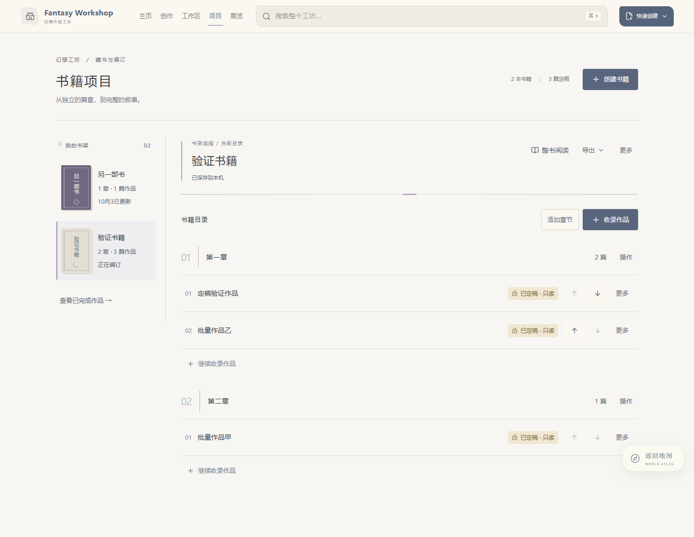
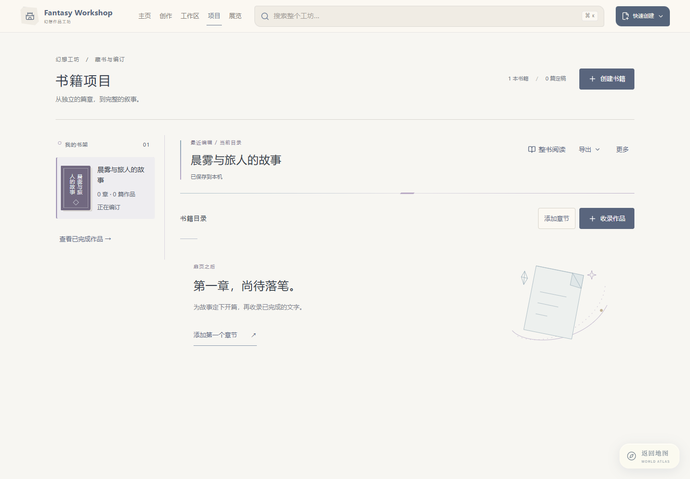

# 书籍编订区减重与新元素

日期：2026-10-03

## 页面与交互

书架保留全部书籍入口，右侧始终只有一个共用目录。每次进入项目页，默认按 updatedAt 显示最近编辑的书籍；手动选择其他书籍时，替换同一编订区的内容。仅查看书籍不会修改更新时间。旧 active-book 本地记录不再影响默认选择。

## 美术调整

- 取消编订区中央、章节标题和书封上的重复花月图案。
- 中央采用一条带淡紫装订记号的细线，降低视觉密度。
- 章节采用页码式双位序号与细竖线，撤去重复渐变色块。
- 书封以短线、晶面菱形、弧线三种小印记区分，保持稳定配色。
- 新增原创 SVG「未写之页」：单页折角承接晶石几何，外围星轨承接月弧意象。仅在无章节时出现，开始编订后自然退场。
- 沿用统一字体，不添加持续动画。

## 素材

素材源：components/ui/UnwrittenLeaf.tsx。采用代码内联 SVG，无外部素材依赖，装饰不进入辅助技术朗读与焦点。

## 验证

生产构建与 TypeScript 检查、修改组件 ESLint 通过。五种屏宽与字体、减少动态效果检查通过。书籍交互回归通过，并新增最近编辑默认选择、手动切换、单一编订区和刷新恢复最近编辑书籍的断言。

截图目录：docs/workshop-ui-evidence/editing-desk。

